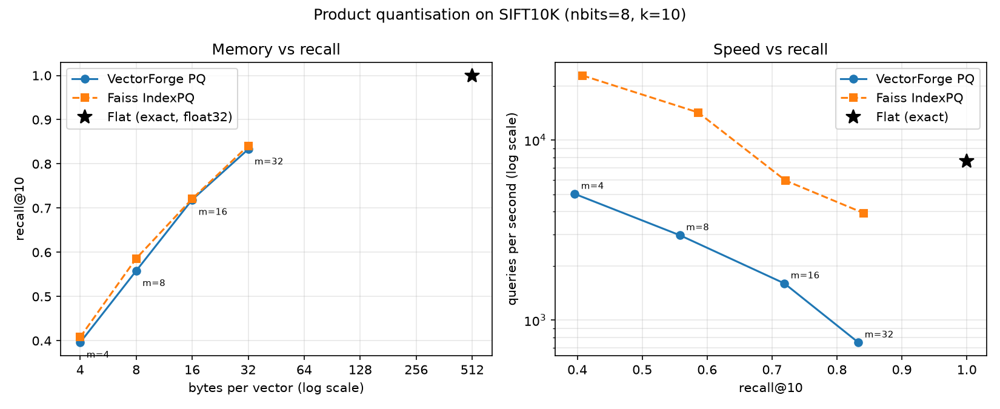
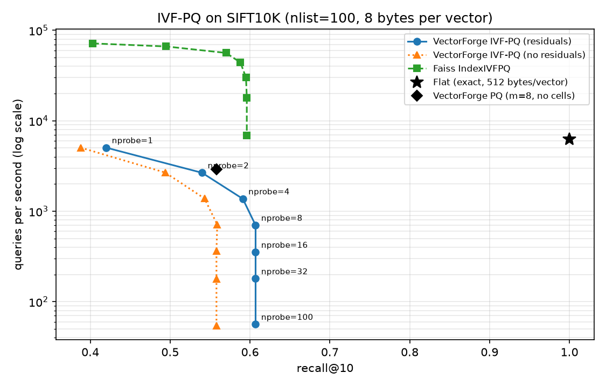
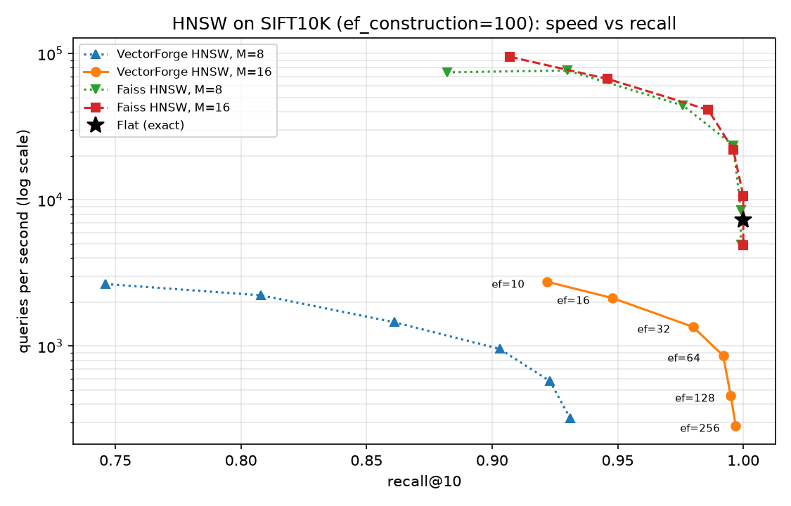

# VectorForge

Approximate nearest-neighbour search written from scratch in NumPy — exact search, IVF, product quantisation and HNSW — benchmarked against Faiss on recall, speed and memory.

> 🚧 In progress: all five indexes are done (exact search, IVF, PQ, IVF-PQ and HNSW). Next: the SIFT1M benchmark and a small search service.

## Results

SIFT10K (10,000 base vectors, 100 queries, 128 dimensions), k = 10, measured on my laptop. Faiss runs single-threaded for a fair comparison. Speeds come from separate runs, and laptop timings vary by up to about 1.5× between runs (Flat measured 4,568 and 7,657 QPS), so compare speeds within one sweep.

| Index | Settings | recall@10 | queries/s | memory (MB) |
|---|---|---|---|---|
| Flat (exact) | — | 1.000 | 4,568 | 5.16 |
| IVF (VectorForge) | nlist=100, nprobe=8 | 0.961 | 1,920 | ≈5.25 |
| IVF (VectorForge) | nlist=100, nprobe=1 | 0.501 | 21,406 | ≈5.25 |
| IVF (Faiss) | nlist=100, nprobe=8 | 0.922 | 32,438 | — |
| PQ (VectorForge) | m=8, 8 bits (8 bytes/vector) | 0.558 | 2,962 | 0.08 + 0.13 codebooks |
| PQ (VectorForge) | m=32, 8 bits (32 bytes/vector) | 0.833 | 752 | 0.32 + 0.13 codebooks |
| PQ (Faiss) | m=8, 8 bits | 0.586 | 14,243 | 0.08 + 0.13 codebooks |
| IVF-PQ (VectorForge) | nlist=100, nprobe=8, m=8 (8-byte codes) | 0.607 | 700 | ≈0.34 (codes 0.08, ids 0.08, codebooks + centroids 0.18) |
| IVF-PQ (Faiss) | nlist=100, nprobe=8, m=8 | 0.588 | 44,098 | — |
| HNSW (VectorForge) | M=16, ef_construction=100, ef_search=64 | 0.992 | 859 | ≈7.8 (vectors 5.12 + ≈33 links/vector at 8 bytes) |
| HNSW (Faiss) | M=16, efConstruction=100, efSearch=64 | 0.996 | 22,078 | — |

## IVF: speed vs recall


Full numbers for every nprobe: [`docs/ivf_sweep.csv`](docs/ivf_sweep.csv).

**Findings**

- **Recall rises with nprobe, with strongly diminishing returns.** A query near the border of its cell has some of its true neighbours in the neighbouring cells, and nprobe = 1 never looks there (recall 0.50). Probing 8 of 100 cells — about 8% of the data — already finds 96% of the true neighbours; reaching 100% takes nprobe = 32, four times the work for the last 4%.
- **On 10,000 vectors my IVF is slower than exact search from nprobe = 8 on, even though it does about 10× less arithmetic.** Exact search computes all 100 × 10,000 distances in a single matrix multiply in optimised compiled code. My IVF search loops over the queries in Python, and for each one gathers and copies the candidate vectors. At this size that per-query overhead outweighs the work saved. Exact search's cost grows linearly with the database while IVF's per-query cost stays small, so the picture should flip on SIFT1M (next benchmark).
- **Faiss is roughly 7–22× faster with the same algorithm.** Its search loop runs in compiled C++ with no per-query interpreter overhead, it stores each cell's vectors contiguously in memory instead of gathering them on every query, and it uses SIMD instructions to process several numbers at once.
- **At the same nprobe my recall is about the same as Faiss's at nprobe = 1 and higher from nprobe = 2 to 16** (e.g. 0.961 vs 0.922 at nprobe = 8). Both are IVF; the difference comes from k-means: I initialise with k-means++, while Faiss starts from randomly sampled centroids by default, so the two indexes end up with different cells and different vectors near cell borders. Both reach recall 1.0 once enough cells are probed, which confirms the implementation is correct.

## Product quantisation: memory vs recall

Each 128-dimensional vector is cut into m pieces. Each piece is replaced by the number of its nearest entry in a 256-entry codebook learned with k-means on that piece, so a vector is stored as m bytes instead of 512. Search never decodes: per query it builds one small distance table per piece, then a vector's distance is the sum of m table lookups (asymmetric distance computation). A test checks that this equals the exact distance to the decoded vector.



| m (bytes/vector) | compression | VectorForge recall@10 | VectorForge QPS | Faiss recall@10 | Faiss QPS | train time (mine / Faiss) |
|---|---|---|---|---|---|---|
| 4 | 128× | 0.396 | 5,023 | 0.408 | 22,840 | 13.6 s / 1.6 s |
| 8 | 64× | 0.558 | 2,962 | 0.586 | 14,243 | 18.0 s / 2.7 s |
| 16 | 32× | 0.719 | 1,600 | 0.721 | 5,954 | 27.0 s / 5.8 s |
| 32 | 16× | 0.833 | 752 | 0.841 | 3,934 | 47.3 s / 25.5 s |
| Flat (exact) | 1× (512 bytes) | 1.000 | 7,657 | — | — | — |

Full numbers: [`docs/pq_sweep.csv`](docs/pq_sweep.csv).

**Findings**

- **More pieces give better recall, paid for in memory.** Going from 4 to 32 bytes per vector raises recall@10 from 0.40 to 0.83. With more pieces each piece is shorter (32 numbers at m = 4, 4 numbers at m = 32), so 256 codebook entries cover it much more densely. The rebuilt vector is a finer approximation of the original, and the ranking gets closer to the exact one.
- **PQ trades recall for a lot of memory.** At m = 8 a vector takes 8 bytes instead of 512 (64× smaller) for recall 0.56. At m = 32 it's 16× smaller for 0.83. On 10,000 vectors that saving doesn't matter, but on a billion SIFT vectors it's 8 GB instead of 512 GB, the difference between fitting in RAM or not. On its own the recall is too low for most uses. In practice PQ is combined with IVF (next) and/or a re-ranking step: take a short candidate list from PQ, then re-rank it with exact distances.
- **On this dataset my PQ is slower than exact search, and halves in speed every time m doubles.** It's not the arithmetic: per stored vector PQ does m lookups instead of 128 multiply-adds, and the distance tables are tiny (100 queries × 256 entries per piece). The cost is that every piece's lookup (`table[:, codes[:, j]]`) builds a new 100 × 10,000 array, so the search time is m full passes over memory (5,023 → 2,962 → 1,600 → 752 QPS). Exact search is a single optimised matrix multiply.
- **Faiss gets the same recall (within 0.03) but searches 3.7–5.2× faster and trains 2–9× faster.** Same algorithm; the small recall differences come from k-means initialisation and training settings. Faiss's compiled C++ loop walks over the codes once and adds up the m table values for each vector. The tables (m × 256 floats) stay in the CPU cache, and no large temporary arrays are created.

## IVF-PQ: cells + compressed codes

IVF-PQ combines the two: IVF's cells decide where to look, and inside each cell vectors are stored as 8-byte PQ codes. With residuals (the default, as in Faiss), PQ encodes each vector's offset from its cell centre instead of the vector itself, and a query is compared as its offset from the same centre.



nlist = 100, m = 8 (8 bytes per vector), SIFT10K, k = 10:

| nprobe | residuals: recall@10 | QPS | no residuals: recall@10 | QPS | Faiss: recall@10 | Faiss QPS |
|---|---|---|---|---|---|---|
| 1 | 0.420 | 5,043 | 0.388 | 5,045 | 0.403 | 71,690 |
| 2 | 0.540 | 2,659 | 0.494 | 2,671 | 0.495 | 66,348 |
| 4 | 0.591 | 1,371 | 0.543 | 1,382 | 0.570 | 56,287 |
| 8 | 0.607 | 700 | 0.559 | 712 | 0.588 | 44,098 |
| 16 | 0.607 | 352 | 0.558 | 362 | 0.595 | 30,045 |
| 100 | 0.607 | 56 | 0.558 | 54 | 0.596 | 6,915 |

Reference points in the same run: plain PQ (m = 8, no cells) 0.558 at 2,902 QPS; Flat 1.000 at 6,288 QPS. Training took 24 s for mine and 3 s for Faiss. Full numbers: [`docs/ivfpq_sweep.csv`](docs/ivfpq_sweep.csv).

**Findings**

- **Residuals add recall at no extra memory.** With the same 8 bytes per vector, encoding offsets gives 0.607 instead of 0.559 at nprobe = 8. Without residuals, probing every cell gives exactly plain PQ's recall (0.558): the cells only decide where to look. With residuals the catalogues learn offsets from the cell centres, which are small and look alike in every cell, so 256 entries per piece describe them much more finely than they can describe raw vectors spread over the whole space.
- **Recall plateaus at 0.607 from nprobe = 8, well below IVF's 1.0.** IVF stores full vectors, so once enough cells are probed its distances are exact. IVF-PQ only has approximations (cell centre + decoded offset), so even with all 100 cells probed some true neighbours are ranked below vectors whose reconstructions happen to sit closer to the query. Probing more cells adds candidates but can't fix the ranking. Going higher needs more bytes per vector (larger m) or a re-ranking step with exact distances on a short candidate list.
- **My IVF-PQ is slower than plain PQ from nprobe = 2 on, even though it scores only about nprobe % of the codes.** The search loops over queries and, inside, over the probed cells: at nprobe = 8 that is 800 calls to the PQ distance function for 100 queries, and each call rebuilds m distance tables because the query's offset is different for every cell. The fixed interpreter and NumPy overhead per call outweighs the arithmetic saved, so QPS halves every time nprobe doubles. Only at nprobe = 1 does it beat plain PQ (5,043 vs 2,902 QPS).
- **Faiss gets similar recall but is 14–123× faster to search and about 8× faster to train.** Same algorithm; my recall is slightly higher from nprobe = 2 on, as with IVF, most likely because my k-means starts from k-means++ and Faiss from random centroids. Faiss runs the loop over each cell's codes in compiled C++, with no per-call interpreter overhead, no large temporary arrays and the small tables kept in the CPU cache. This is where my implementation's Python loops cost the most.

## HNSW: graph search

HNSW links every vector to its nearest neighbours and stacks sparser copies of that graph on top, like zoom levels on a map. A search starts at the top layer, walks greedily towards the query, drops a layer, and finishes with a best-first search on layer 0 that keeps a shortlist of `ef_search` candidates. Vectors are stored in full, so distances are exact; the only approximation is which vectors the walk reaches.



ef_construction = 100, SIFT10K, k = 10:

| ef_search | mine, M=8: recall@10 | QPS | mine, M=16: recall@10 | QPS | Faiss, M=8: recall@10 | Faiss, M=16: recall@10 | Faiss M=16 QPS |
|---|---|---|---|---|---|---|---|
| 10 | 0.746 | 2,657 | 0.922 | 2,749 | 0.882 | 0.907 | 95,220 |
| 32 | 0.861 | 1,456 | 0.980 | 1,352 | 0.976 | 0.986 | 41,293 |
| 64 | 0.903 | 956 | 0.992 | 859 | 0.996 | 0.996 | 22,078 |
| 256 | 0.931 | 322 | 0.997 | 284 | 0.999 | 1.000 | 4,882 |

Build time: 17.8 s (M = 8) and 23.8 s (M = 16) for mine, 0.6–0.7 s for Faiss. Links per vector: 17.1 (M = 8) and 33.1 (M = 16). Flat in the same run: 1.000 at 7,315 QPS. Full numbers: [`docs/hnsw_sweep.csv`](docs/hnsw_sweep.csv).

**Findings**

- **ef_search trades speed for recall, with diminishing returns.** It is the size of the shortlist on layer 0: a bigger shortlist explores more nodes before it stops, so it misses fewer neighbours but measures more distances. At M = 16, going from 10 to 64 lifts recall from 0.922 to 0.992 for about 3× less speed; going on to 256 adds only 0.005 for another 3×.
- **More links (M = 16) give much better recall, paid for in memory and build time.** With more neighbours per node there are more routes to the target and fewer dead ends: 0.922 vs 0.746 at ef_search = 10, and M = 8 never gets past 0.931. It costs 33 instead of 17 links per vector (about 2.6 MB of graph on top of the 5.1 MB of vectors, counting 8 bytes per link) and 34% longer builds. Search speed at the same ef_search is about the same.
- **On 10,000 vectors my HNSW is about 8× slower than exact search at recall 0.99.** It does far less arithmetic, but in many tiny steps: each query pops nodes one at a time from a heap, measures a handful of neighbours per step in a small NumPy call, and the 100 queries run one after another. Flat does all 100 × 10,000 distances in one optimised matrix multiply. Flat's cost grows with the number of vectors while HNSW's grows roughly with its logarithm, so this should flip on SIFT1M. Faiss's compiled HNSW is already 3× faster than my Flat here.
- **Faiss is 15–35× faster to search and about 30× faster to build, and at M = 8 it also gets much better recall (0.882 vs 0.746 at ef_search = 10).** The speed comes from compiled loops. The recall gap comes from how neighbours are chosen: my insert links each vector to its M closest candidates, which can all sit on the same side of it. Faiss uses the paper's selection heuristic, which skips a candidate that is closer to an already-chosen neighbour than to the new vector, so the links point in different directions and the graph stays navigable. With few links (M = 8) that matters a lot; at M = 16 there are enough links that the two are close (0.922 vs 0.907).

## Run it

```bash
pip install -e ".[dev]"
pytest                          # unit tests
python -m vectorforge.bench     # exact-search benchmark on SIFT10K (see data/README.md to download it)
pip install faiss-cpu
python scripts/sweep_ivf.py     # IVF nprobe sweep vs Faiss → docs/ivf_sweep.csv and .png
python scripts/sweep_pq.py      # PQ sweep over m vs Faiss → docs/pq_sweep.csv and .png
python scripts/sweep_ivfpq.py   # IVF-PQ nprobe sweep, with/without residuals, vs Faiss → docs/ivfpq_sweep.csv and .png
python scripts/sweep_hnsw.py    # HNSW ef_search sweep at M = 8 and 16 vs Faiss → docs/hnsw_sweep.csv and .png
```

## Layout

- `vectorforge/io.py` — readers for the `.fvecs` / `.ivecs` dataset format
- `vectorforge/flat.py` — exact search (the baseline)
- `vectorforge/metrics.py` — recall@k
- `vectorforge/kmeans.py` — k-means with k-means++ initialisation
- `vectorforge/ivf.py` — IVF index: k-means cells, inverted lists, nprobe search
- `vectorforge/pq.py` — product quantisation: per-piece codebooks, 1-byte codes, lookup-table (ADC) search
- `vectorforge/ivfpq.py` — IVF-PQ: IVF cells holding PQ codes of residuals, per-cell table lookups
- `vectorforge/hnsw.py` — HNSW: layered neighbour graph, best-first search with two heaps, insert with pruning
- `vectorforge/bench.py` — one harness that measures every index the same way
- `scripts/sweep_ivf.py` — IVF recall/speed sweep against Faiss
- `scripts/sweep_pq.py` — PQ recall/memory/speed sweep against Faiss
- `scripts/sweep_ivfpq.py` — IVF-PQ nprobe sweep with and without residuals against Faiss
- `scripts/sweep_hnsw.py` — HNSW ef_search sweep at two graph sizes against Faiss
