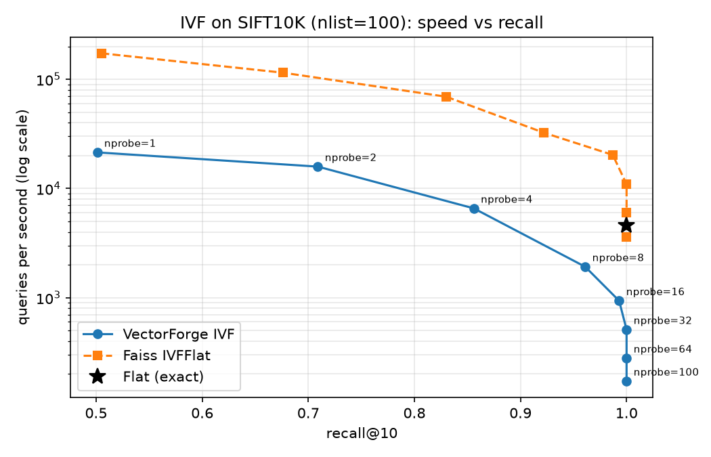
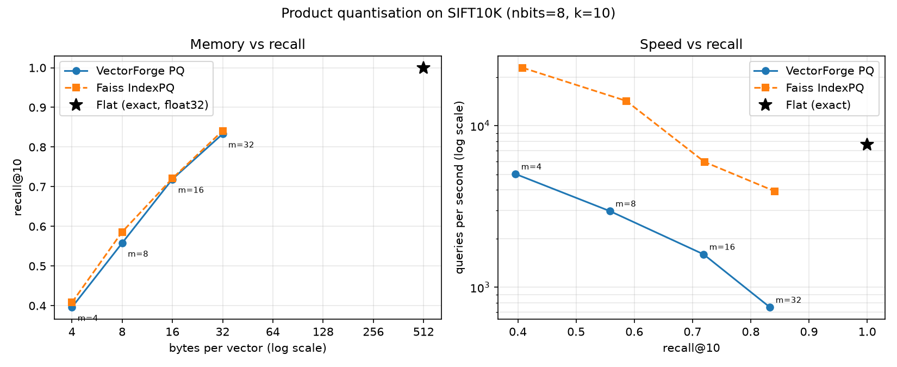
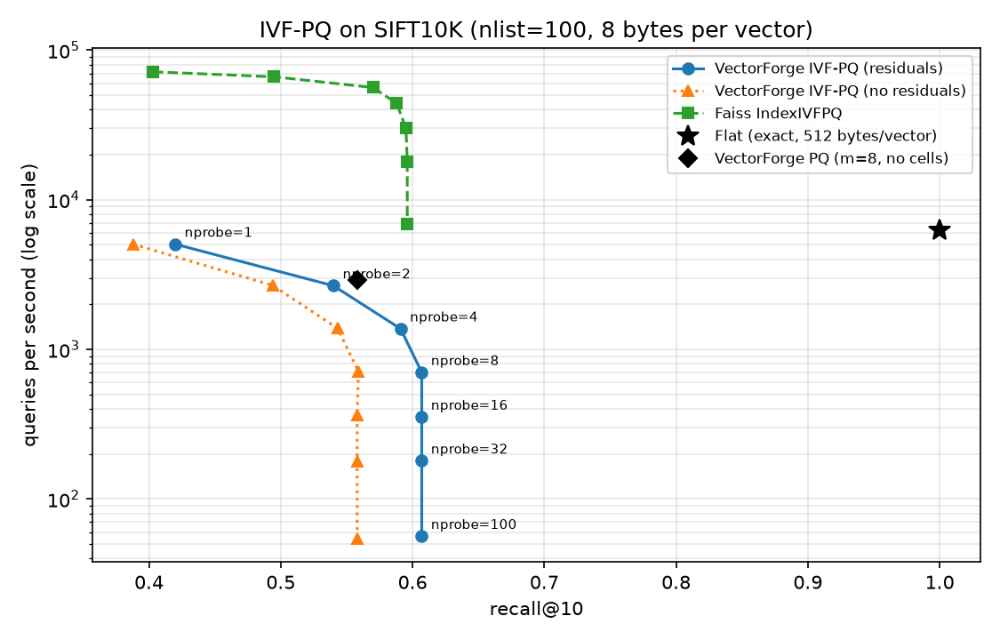
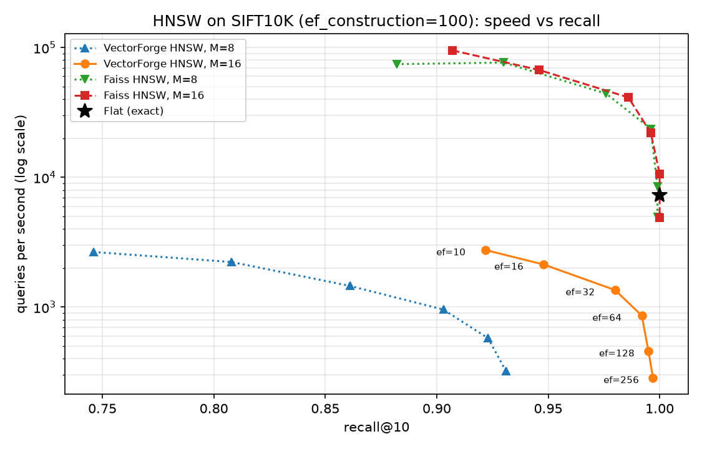
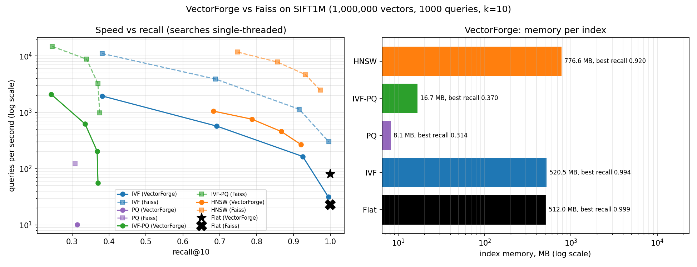
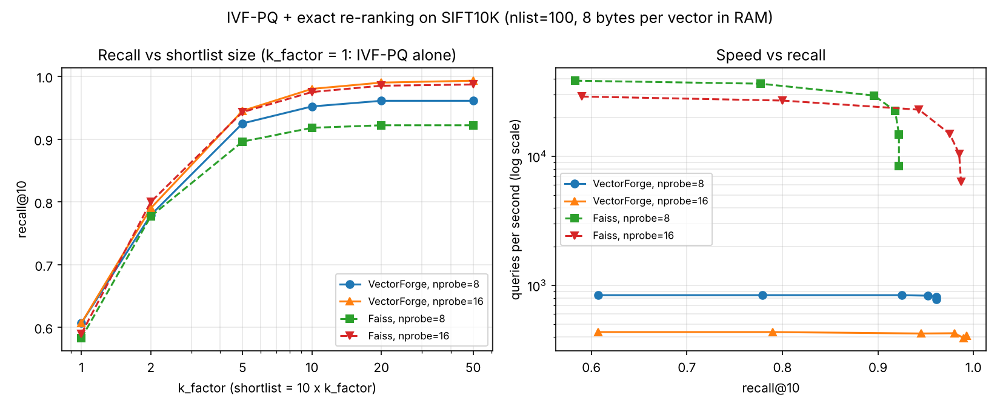
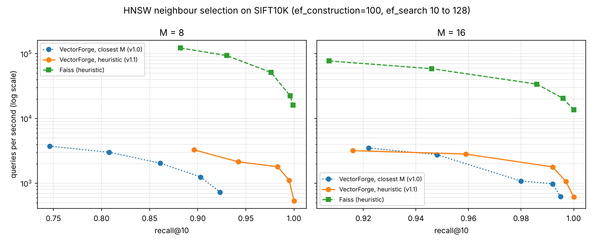

# VectorForge

[](https://github.com/DHaKK-SHeSH/vectorforge/actions/workflows/ci.yml)

Approximate nearest-neighbour search written from scratch in NumPy: the index types inside vector databases like Faiss, Milvus and Qdrant, built one by one, tested, and benchmarked against Faiss on 10 thousand and 1 million vectors.

**What's inside**

- **Five indexes:** exact search, IVF (k-means cells), product quantisation (PQ), IVF-PQ (cells + compressed codes) and HNSW (a layered neighbour graph)
- **Two fixes for what the benchmarks found (v1.1):** exact re-ranking for compressed indexes, and HNSW's neighbour-selection heuristic
- **Benchmarks** against Faiss on SIFT10K and SIFT1M: recall, speed, memory and build time
- **Save / load** for every index (one file, no pickle) and a **FastAPI search service** with a Dockerfile
- 100+ tests, run on GitHub Actions on every push

## Which index when

Every index trades between recall, speed, memory and build time. From my measurements:

| You need | Use | Why (numbers from this repo) |
|---|---|---|
| near-perfect answers, or a small collection | **exact search** | always 100%; on 10k vectors it was also the fastest at high recall |
| fast queries at 90-99% recall, memory not tight | **HNSW** (M = 16) | 3.3x faster than exact search at 92% on 1M vectors; but 777 MB and a 58-minute build in Python |
| a quick build and decent speed | **IVF** | built in 1.6 min on 1M vectors (vs 58 for HNSW), 2x faster than exact at 92% |
| very little memory | **IVF-PQ + re-ranking** | 8 bytes per vector in RAM (64x smaller), full vectors on disk; re-ranking lifts recall from 0.61 to 0.95 on SIFT10K |
| the smallest possible index, accuracy secondary | **PQ** | 8 bytes per vector, but only 31% recall on 1M without re-ranking |

**Headlines**

- **SIFT1M (1 million vectors):** my IVF is 2x and my HNSW 3.3x faster than exact search at about 92% recall. [Details](#sift1m-does-it-scale)
- **Re-ranking (v1.1):** IVF-PQ's recall goes from 0.61 to 0.95 at the same speed, with only 0.34 MB in RAM. [Details](#v11-fixing-what-the-benchmarks-found)
- **HNSW heuristic (v1.1):** at M = 8, recall at ef_search = 10 goes from 0.75 to 0.90 (Faiss: 0.88), with 27% fewer links. [Details](#v11-fixing-what-the-benchmarks-found)
- **Faiss is about 4-120x faster** with the same algorithms (compiled loops vs my Python loops), while my recall matches it.

## Results on SIFT10K

SIFT10K (10,000 base vectors, 100 queries, 128 dimensions), k = 10, measured on my laptop. Faiss runs single-threaded for a fair comparison. Speeds come from separate runs, and laptop timings vary by up to about 1.5× between runs (Flat measured 4,568 and 7,657 QPS), so compare speeds within one sweep.

| Index | Settings | recall@10 | queries/s | memory (MB) |
|---|---|---|---|---|
| Flat (exact) | — | 1.000 | 4,568 | 5.16 |
| IVF (VectorForge) | nlist=100, nprobe=8 | 0.961 | 1,920 | ≈5.25 |
| IVF (VectorForge) | nlist=100, nprobe=1 | 0.501 | 21,406 | ≈5.25 |
| IVF (Faiss) | nlist=100, nprobe=8 | 0.922 | 32,438 | — |
| PQ (VectorForge) | m=8, 8 bits (8 bytes/vector) | 0.558 | 2,962 | 0.08 + 0.13 codebooks |
| PQ (VectorForge) | m=32, 8 bits (32 bytes/vector) | 0.833 | 752 | 0.32 + 0.13 codebooks |
| PQ (Faiss) | m=8, 8 bits | 0.586 | 14,243 | 0.08 + 0.13 codebooks |
| IVF-PQ (VectorForge) | nlist=100, nprobe=8, m=8 (8-byte codes) | 0.607 | 700 | ≈0.34 (codes 0.08, ids 0.08, codebooks + centroids 0.18) |
| IVF-PQ (Faiss) | nlist=100, nprobe=8, m=8 | 0.588 | 44,098 | — |
| HNSW (VectorForge, v1.0) | M=16, ef_construction=100, ef_search=64 | 0.992 | 859 | ≈7.8 (vectors 5.12 + ≈33 links/vector at 8 bytes) |
| HNSW (Faiss) | M=16, efConstruction=100, efSearch=64 | 0.996 | 22,078 | — |

## IVF: speed vs recall



Full numbers for every nprobe: [`docs/ivf_sweep.csv`](docs/ivf_sweep.csv).

**Findings**

- **Recall rises with nprobe, with strongly diminishing returns.** A query near the border of its cell has some of its true neighbours in the neighbouring cells, and nprobe = 1 never looks there (recall 0.50). Probing 8 of 100 cells — about 8% of the data — already finds 96% of the true neighbours; reaching 100% takes nprobe = 32, four times the work for the last 4%.
- **On 10,000 vectors my IVF is slower than exact search from nprobe = 8 on, even though it does about 10× less arithmetic.** Exact search computes all 100 × 10,000 distances in a single matrix multiply in optimised compiled code. My IVF search loops over the queries in Python, and for each one gathers and copies the candidate vectors. At this size that per-query overhead outweighs the work saved. Exact search's cost grows linearly with the database while IVF's per-query cost stays small, so the picture should flip on SIFT1M (next benchmark).
- **Faiss is roughly 7–22× faster with the same algorithm.** Its search loop runs in compiled C++ with no per-query interpreter overhead, it stores each cell's vectors contiguously in memory instead of gathering them on every query, and it uses SIMD instructions to process several numbers at once.
- **At the same nprobe my recall is about the same as Faiss's at nprobe = 1 and higher from nprobe = 2 to 16** (e.g. 0.961 vs 0.922 at nprobe = 8). Both are IVF; the difference comes from k-means: I initialise with k-means++, while Faiss starts from randomly sampled centroids by default, so the two indexes end up with different cells and different vectors near cell borders. Both reach recall 1.0 once enough cells are probed, which confirms the implementation is correct.

## Product quantisation: memory vs recall

Each 128-dimensional vector is cut into m pieces. Each piece is replaced by the number of its nearest entry in a 256-entry codebook learned with k-means on that piece, so a vector is stored as m bytes instead of 512. Search never decodes: per query it builds one small distance table per piece, then a vector's distance is the sum of m table lookups (asymmetric distance computation). A test checks that this equals the exact distance to the decoded vector.



| m (bytes/vector) | compression | VectorForge recall@10 | VectorForge QPS | Faiss recall@10 | Faiss QPS | train time (mine / Faiss) |
|---|---|---|---|---|---|---|
| 4 | 128× | 0.396 | 5,023 | 0.408 | 22,840 | 13.6 s / 1.6 s |
| 8 | 64× | 0.558 | 2,962 | 0.586 | 14,243 | 18.0 s / 2.7 s |
| 16 | 32× | 0.719 | 1,600 | 0.721 | 5,954 | 27.0 s / 5.8 s |
| 32 | 16× | 0.833 | 752 | 0.841 | 3,934 | 47.3 s / 25.5 s |
| Flat (exact) | 1× (512 bytes) | 1.000 | 7,657 | — | — | — |

Full numbers: [`docs/pq_sweep.csv`](docs/pq_sweep.csv).

**Findings**

- **More pieces give better recall, paid for in memory.** Going from 4 to 32 bytes per vector raises recall@10 from 0.40 to 0.83. With more pieces each piece is shorter (32 numbers at m = 4, 4 numbers at m = 32), so 256 codebook entries cover it much more densely. The rebuilt vector is a finer approximation of the original, and the ranking gets closer to the exact one.
- **PQ trades recall for a lot of memory.** At m = 8 a vector takes 8 bytes instead of 512 (64× smaller) for recall 0.56. At m = 32 it's 16× smaller for 0.83. On 10,000 vectors that saving doesn't matter, but on a billion SIFT vectors it's 8 GB instead of 512 GB, the difference between fitting in RAM or not. On its own the recall is too low for most uses. In practice PQ is combined with IVF (next) and/or a re-ranking step: take a short candidate list from PQ, then re-rank it with exact distances.
- **On this dataset my PQ is slower than exact search, and halves in speed every time m doubles.** It's not the arithmetic: per stored vector PQ does m lookups instead of 128 multiply-adds, and the distance tables are tiny (100 queries × 256 entries per piece). The cost is that every piece's lookup (`table[:, codes[:, j]]`) builds a new 100 × 10,000 array, so the search time is m full passes over memory (5,023 → 2,962 → 1,600 → 752 QPS). Exact search is a single optimised matrix multiply.
- **Faiss gets the same recall (within 0.03) but searches 3.7–5.2× faster and trains 2–9× faster.** Same algorithm; the small recall differences come from k-means initialisation and training settings. Faiss's compiled C++ loop walks over the codes once and adds up the m table values for each vector. The tables (m × 256 floats) stay in the CPU cache, and no large temporary arrays are created.

## IVF-PQ: cells + compressed codes

IVF-PQ combines the two: IVF's cells decide where to look, and inside each cell vectors are stored as 8-byte PQ codes. With residuals (the default, as in Faiss), PQ encodes each vector's offset from its cell centre instead of the vector itself, and a query is compared as its offset from the same centre.



nlist = 100, m = 8 (8 bytes per vector), SIFT10K, k = 10:

| nprobe | residuals: recall@10 | QPS | no residuals: recall@10 | QPS | Faiss: recall@10 | Faiss QPS |
|---|---|---|---|---|---|---|
| 1 | 0.420 | 5,043 | 0.388 | 5,045 | 0.403 | 71,690 |
| 2 | 0.540 | 2,659 | 0.494 | 2,671 | 0.495 | 66,348 |
| 4 | 0.591 | 1,371 | 0.543 | 1,382 | 0.570 | 56,287 |
| 8 | 0.607 | 700 | 0.559 | 712 | 0.588 | 44,098 |
| 16 | 0.607 | 352 | 0.558 | 362 | 0.595 | 30,045 |
| 100 | 0.607 | 56 | 0.558 | 54 | 0.596 | 6,915 |

Reference points in the same run: plain PQ (m = 8, no cells) 0.558 at 2,902 QPS; Flat 1.000 at 6,288 QPS. Training took 24 s for mine and 3 s for Faiss. Full numbers: [`docs/ivfpq_sweep.csv`](docs/ivfpq_sweep.csv).

**Findings**

- **Residuals add recall at no extra memory.** With the same 8 bytes per vector, encoding offsets gives 0.607 instead of 0.559 at nprobe = 8. Without residuals, probing every cell gives exactly plain PQ's recall (0.558): the cells only decide where to look. With residuals the catalogues learn offsets from the cell centres, which are small and look alike in every cell, so 256 entries per piece describe them much more finely than they can describe raw vectors spread over the whole space.
- **Recall plateaus at 0.607 from nprobe = 8, well below IVF's 1.0.** IVF stores full vectors, so once enough cells are probed its distances are exact. IVF-PQ only has approximations (cell centre + decoded offset), so even with all 100 cells probed some true neighbours are ranked below vectors whose reconstructions happen to sit closer to the query. Probing more cells adds candidates but can't fix the ranking. Going higher needs more bytes per vector (larger m) or a re-ranking step with exact distances on a short candidate list.
- **My IVF-PQ is slower than plain PQ from nprobe = 2 on, even though it scores only about nprobe % of the codes.** The search loops over queries and, inside, over the probed cells: at nprobe = 8 that is 800 calls to the PQ distance function for 100 queries, and each call rebuilds m distance tables because the query's offset is different for every cell. The fixed interpreter and NumPy overhead per call outweighs the arithmetic saved, so QPS halves every time nprobe doubles. Only at nprobe = 1 does it beat plain PQ (5,043 vs 2,902 QPS).
- **Faiss gets similar recall but is 14–123× faster to search and about 8× faster to train.** Same algorithm; my recall is slightly higher from nprobe = 2 on, as with IVF, most likely because my k-means starts from k-means++ and Faiss from random centroids. Faiss runs the loop over each cell's codes in compiled C++, with no per-call interpreter overhead, no large temporary arrays and the small tables kept in the CPU cache. This is where my implementation's Python loops cost the most.

## HNSW: graph search

*These are the v1.0 results, where each new vector simply linked to its M closest candidates. v1.1 adds the neighbour-selection heuristic: see [below](#v11-fixing-what-the-benchmarks-found).*

HNSW links every vector to its nearest neighbours and stacks sparser copies of that graph on top, like zoom levels on a map. A search starts at the top layer, walks greedily towards the query, drops a layer, and finishes with a best-first search on layer 0 that keeps a shortlist of `ef_search` candidates. Vectors are stored in full, so distances are exact; the only approximation is which vectors the walk reaches.



ef_construction = 100, SIFT10K, k = 10:

| ef_search | mine, M=8: recall@10 | QPS | mine, M=16: recall@10 | QPS | Faiss, M=8: recall@10 | Faiss, M=16: recall@10 | Faiss M=16 QPS |
|---|---|---|---|---|---|---|---|
| 10 | 0.746 | 2,657 | 0.922 | 2,749 | 0.882 | 0.907 | 95,220 |
| 32 | 0.861 | 1,456 | 0.980 | 1,352 | 0.976 | 0.986 | 41,293 |
| 64 | 0.903 | 956 | 0.992 | 859 | 0.996 | 0.996 | 22,078 |
| 256 | 0.931 | 322 | 0.997 | 284 | 0.999 | 1.000 | 4,882 |

Build time: 17.8 s (M = 8) and 23.8 s (M = 16) for mine, 0.6–0.7 s for Faiss. Links per vector: 17.1 (M = 8) and 33.1 (M = 16). Flat in the same run: 1.000 at 7,315 QPS. Full numbers: [`docs/hnsw_sweep.csv`](docs/hnsw_sweep.csv).

**Findings**

- **ef_search trades speed for recall, with diminishing returns.** It is the size of the shortlist on layer 0: a bigger shortlist explores more nodes before it stops, so it misses fewer neighbours but measures more distances. At M = 16, going from 10 to 64 lifts recall from 0.922 to 0.992 for about 3× less speed; going on to 256 adds only 0.005 for another 3×.
- **More links (M = 16) give much better recall, paid for in memory and build time.** With more neighbours per node there are more routes to the target and fewer dead ends: 0.922 vs 0.746 at ef_search = 10, and M = 8 never gets past 0.931. It costs 33 instead of 17 links per vector (about 2.6 MB of graph on top of the 5.1 MB of vectors, counting 8 bytes per link) and 34% longer builds. Search speed at the same ef_search is about the same.
- **On 10,000 vectors my HNSW is about 8× slower than exact search at recall 0.99.** It does far less arithmetic, but in many tiny steps: each query pops nodes one at a time from a heap, measures a handful of neighbours per step in a small NumPy call, and the 100 queries run one after another. Flat does all 100 × 10,000 distances in one optimised matrix multiply. Flat's cost grows with the number of vectors while HNSW's grows roughly with its logarithm, so this should flip on SIFT1M. Faiss's compiled HNSW is already 3× faster than my Flat here.
- **Faiss is 15–35× faster to search and about 30× faster to build, and at M = 8 it also gets much better recall (0.882 vs 0.746 at ef_search = 10).** The speed comes from compiled loops. The recall gap comes from how neighbours are chosen: my insert links each vector to its M closest candidates, which can all sit on the same side of it. Faiss uses the paper's selection heuristic, which skips a candidate that is closer to an already-chosen neighbour than to the new vector, so the links point in different directions and the graph stays navigable. With few links (M = 8) that matters a lot; at M = 16 there are enough links that the two are close (0.922 vs 0.907).

## SIFT1M: does it scale?

On 10,000 vectors, exact search beat almost everything. So I ran every index again on **1,000,000** vectors (SIFT1M), 100× more, to see if that changes. Same code, run on a Kaggle CPU with 1,000 queries: [`notebooks/sift1m_benchmark.ipynb`](notebooks/sift1m_benchmark.ipynb).



| Index | Setting | recall@10 | queries/s | memory (MB) | build time | Faiss: recall@10 | Faiss: queries/s |
|---|---|---|---|---|---|---|---|
| Flat (exact) | — | 0.999 ** | 80 | 512 | — | 0.999 | 23 * |
| IVF | nprobe = 16 | 0.925 | 165 | 521 | 1.6 min | 0.916 | 1,134 |
| IVF | nprobe = 64 | 0.994 | 32 | 521 | 1.6 min | 0.995 | 301 |
| PQ | m = 8 | 0.314 | 10 | 8 | 2.0 min | 0.308 | 121 |
| IVF-PQ | nprobe = 16 | 0.368 | 204 | 17 | 3.6 min | 0.370 | 3,246 |
| HNSW | ef_search = 16 | 0.683 | 1,053 | 777 | 58 min | 0.749 | 11,728 |
| HNSW | ef_search = 128 | 0.920 | 267 | 777 | 58 min | 0.972 | 2,472 |

Settings: nlist = 1024, m = 8 (8 bytes per vector), HNSW M = 16 with ef_construction = 64. Faiss searches ran on one CPU core; Faiss builds used all cores. \*\* Exact search scores 0.999 rather than 1.000 because for a few queries the 10th and 11th neighbours are tied or differ only by rounding, so the order can flip. Full numbers: [`docs/sift1m_results.csv`](docs/sift1m_results.csv).

**What I learned**

- **At a million vectors, approximate search finally pays off, as long as about 90% is good enough.** Exact search has to check all 1,000,000 vectors for every query. IVF with nprobe = 16 only looks at about 16,000 of them and still finds 92.5% of the true neighbours, twice as fast. HNSW finds 92% while being 3.3× faster, and 13× faster if 68% is enough.
- **If you need about 99% of the answers right, exact search still wins here.** To get IVF to 99.4%, it has to look in 64 cells, about 6% of everything, and my Python loop makes that slower than one big exact matrix multiply (32 vs 80 queries per second). The closer you want to get to perfect, the more an approximate index has to look at, until it might as well check everything. Faiss, with compiled loops, still wins at 99% (301 queries per second).
- **8-byte codes lose a lot at this size.** PQ dropped from 56% recall on 10,000 vectors to 31% here, and IVF-PQ from 61% to 37%, with exactly the same 8 bytes per vector. With 100× more vectors in the same space, a query's true neighbours sit very close to each other, closer than the rounding error of an 8-byte code, so the codes can't tell which one is really nearest. Like describing houses only by their street: fine in a village, useless in a city. The fix is more bytes per vector, or re-checking a short list with exact distances.
- **Every index is a trade-off between four things: recall, speed, memory and build time.** None wins at all four. From these numbers:
    - need about 99% right: **exact search** (or Faiss IVF)
    - very little memory (about 20 MB for a million vectors): **IVF-PQ**, 30× smaller than the vectors, but only with a re-ranking step to fix its recall
    - fast queries at about 90%: **HNSW**, 1.6× faster than IVF at the same recall, but it needs 50% more memory than IVF and took 58 minutes to build instead of 1.6
- \* **A note on fairness:** my exact search (80 queries/s) beat Faiss's (23) only because NumPy's matrix multiply automatically used every CPU core, while I limited Faiss to one. Everywhere else my code runs mostly on one core in Python loops, and Faiss is 6–18× faster at searching.

## v1.1: fixing what the benchmarks found

The benchmarks above left two clear weaknesses, both written down in the findings. v1.1 fixes both.

### A. Exact re-ranking for compressed indexes

**The problem:** IVF-PQ's recall stops at 0.61 on SIFT10K and 0.37 on SIFT1M, because 8-byte codes can't tell close neighbours apart.

**The fix** (`vectorforge/refine.py`, what Faiss calls `IndexRefineFlat`): ask IVF-PQ for a **shortlist** of k x k_factor candidates (e.g. 100), then measure the **exact** distance to each with the original vectors and keep the best k. IVF-PQ only has to get the true neighbours somewhere into the shortlist, not in the right order. Only those 100 full vectors are read per query, so they can stay **on disk** (a memory-mapped file) while only the codes sit in RAM.



IVF-PQ, nlist = 100, m = 8, SIFT10K, k = 10. RAM: 0.34 MB; full vectors on disk: 5.12 MB.

| k_factor (shortlist) | nprobe 8: recall@10 | QPS | nprobe 16: recall@10 | QPS | Faiss, nprobe 16: recall@10 |
|---|---|---|---|---|---|
| 1 (10, IVF-PQ alone) | 0.607 | 839 | 0.607 | 435 | 0.590 |
| 2 (20) | 0.779 | 840 | 0.790 | 435 | 0.800 |
| 5 (50) | 0.925 | 840 | 0.945 | 424 | 0.943 |
| 10 (100) | 0.952 | 832 | 0.980 | 426 | 0.975 |
| 20 (200) | 0.961 | 817 | 0.990 | 390 | 0.985 |

Full numbers: [`docs/refine_sweep.csv`](docs/refine_sweep.csv). This sweep ran on a different machine than the tables above (a cloud container), so compare speeds only within this table.

- **Recall jumps from 0.61 to 0.95 at the same speed.** Measuring 100 exact distances per query costs almost nothing next to IVF-PQ's own search, so QPS barely moves.
- **The new ceiling is IVF's, not PQ's.** With nprobe = 8, recall stops at 0.961, exactly IVF's recall at nprobe = 8 (0.961, table above): re-ranking fixes the order, but it can't find neighbours in cells that were never visited. Probing 16 cells raises the ceiling to 0.99.
- **The memory trade-off is the point:** only 0.34 MB has to be in RAM. On a billion vectors that's the difference between 8 GB of codes in RAM with 512 GB on SSD, and 512 GB of RAM.

### B. HNSW's neighbour-selection heuristic

**The problem:** at M = 8, my HNSW reached only 0.75 recall at ef_search = 10, where Faiss reached 0.88 with the same settings.

**The fix** (`HNSWIndex(heuristic=True)`, now the default): when choosing a new vector's links, go through the candidates closest first and keep one only if it is **closer to the new vector than to every link already kept**. My v1.0 code simply took the M closest, which can all sit on one side; the heuristic (from the HNSW paper, also used by Faiss) spreads the links in different directions, so searches coming from any side can reach the vector. The same rule is used when a node has too many links and has to drop some.



SIFT10K, ef_construction = 100, k = 10:

| ef_search | M=8, v1.0 | M=8, heuristic | Faiss M=8 | M=16, v1.0 | M=16, heuristic | Faiss M=16 |
|---|---|---|---|---|---|---|
| 10 | 0.746 | **0.896** | 0.882 | 0.922 | 0.916 | 0.907 |
| 32 | 0.861 | **0.983** | 0.976 | 0.980 | **0.992** | 0.986 |
| 64 | 0.903 | **0.995** | 0.996 | 0.992 | **0.997** | 0.996 |
| 128 | 0.923 | **1.000** | 0.999 | 0.995 | **1.000** | 1.000 |
| links per vector | 17.1 | **12.4** | | 33.1 | **15.7** | |

Full numbers: [`docs/hnsw_heuristic_sweep.csv`](docs/hnsw_heuristic_sweep.csv) (same cloud machine as A).

- **The M = 8 gap with Faiss is closed:** 0.896 vs Faiss's 0.882 at ef_search = 10, and 1.000 at 128 instead of getting stuck at 0.93.
- **Fewer links, better graph.** The heuristic keeps fewer links (12 instead of 17 per vector at M = 8, half as many at M = 16), because links that only duplicate a direction are skipped. That's less memory, and recall still goes up: where the links point matters more than how many there are.
- **The cost is build time** at M = 8 (23 s vs 17 s): every candidate is compared with the links already kept. At M = 16 the build is even a little faster, because nodes keep fewer links and have less to prune.

## Save, load and serve

Building an index takes a while (20 seconds for HNSW on SIFT10K, an hour on SIFT1M), so you only want to do it once. `vectorforge.persist` writes any of the five indexes (and a re-ranking wrapper) to a single `.npz` file and reads it back, and a small FastAPI app serves searches from it over HTTP.

```python
from vectorforge.persist import save, load
save(index, "index.vf.npz")
index = load("index.vf.npz")      # same results, no rebuilding
```

- **One file, plain arrays.** Settings go in a small JSON string inside the file; everything else is NumPy arrays. Lists with different lengths (IVF's cells, HNSW's neighbour lists) are stored as one long array plus the positions where each piece starts.
- **Loading is fast.** On SIFT10K the HNSW graph took 20 s to build and 0.02 s to load (8 MB on disk); IVF-PQ is 0.3 MB.
- **Safe to open.** Files are read with `allow_pickle=False`, so loading a file from someone else can't run code.
- **HNSW can keep growing after a reload:** the random-level generator is saved too, so adding vectors to a loaded graph gives exactly the same graph as adding them to the original. A test checks this.

**The search service**

```bash
pip install -e ".[service]"
python scripts/build_index.py --kind hnsw --out index.vf.npz     # build on SIFT10K, save, check the round trip
VF_INDEX=index.vf.npz uvicorn vectorforge.service:app --port 8000
# PowerShell: $env:VF_INDEX = "index.vf.npz"; uvicorn vectorforge.service:app --port 8000
```

| Endpoint | What it does |
|---|---|
| `GET /health` | what's loaded (index type, number of vectors, dimension, settings) and how many searches and queries it has served |
| `POST /search` | `{"vectors": [[...128 numbers...]], "k": 10, "ef_search": 64}` → `{"ids": [[...]], "distances": [[...]], "took_ms": 5.3}` |
| `GET /docs` | an interactive page to try the API in the browser (made by FastAPI) |

`nprobe` (IVF, IVF-PQ), `ef_search` (HNSW) and `k_factor` (re-ranking) can be set per request without changing the index's defaults. To serve IVF-PQ with re-ranking: `python scripts/build_index.py --kind ivfpq --refine 10 --out index.vf.npz`. Wrong dimensions or a setting that doesn't fit the index type return a clear 422 error. The service is read-only: it loads the index once at start-up and only searches. There's also a `Dockerfile` that runs the same service in a container, with the index file mounted from outside.

## Run it

```bash
pip install -e ".[dev]"
pytest                          # unit tests
python -m vectorforge.bench     # exact-search benchmark on SIFT10K (see data/README.md to download it)
pip install faiss-cpu
python scripts/sweep_ivf.py     # IVF nprobe sweep vs Faiss → docs/ivf_sweep.csv and .png
python scripts/sweep_pq.py      # PQ sweep over m vs Faiss → docs/pq_sweep.csv and .png
python scripts/sweep_ivfpq.py   # IVF-PQ nprobe sweep, with/without residuals, vs Faiss → docs/ivfpq_sweep.csv and .png
python scripts/sweep_hnsw.py    # HNSW ef_search sweep at M = 8 and 16 vs Faiss → docs/hnsw_sweep.csv and .png
python scripts/sweep_refine.py  # v1.1: IVF-PQ + exact re-ranking over k_factor → docs/refine_sweep.csv and .png
python scripts/sweep_hnsw_heuristic.py   # v1.1: HNSW closest-M vs heuristic → docs/hnsw_heuristic_sweep.csv and .png
# SIFT1M: run notebooks/sift1m_benchmark.ipynb on Kaggle (CPU, internet on, about 1.5 hours)
python scripts/build_index.py --kind hnsw --out index.vf.npz   # build + save an index
uvicorn vectorforge.service:app                                # serve it (set VF_INDEX first, see above)
```

## Layout

- `vectorforge/io.py` — readers for the `.fvecs` / `.ivecs` dataset format
- `vectorforge/flat.py` — exact search (the baseline)
- `vectorforge/metrics.py` — recall@k
- `vectorforge/kmeans.py` — k-means with k-means++ initialisation
- `vectorforge/ivf.py` — IVF index: k-means cells, inverted lists, nprobe search
- `vectorforge/pq.py` — product quantisation: per-piece codebooks, 1-byte codes, lookup-table (ADC) search
- `vectorforge/ivfpq.py` — IVF-PQ: IVF cells holding PQ codes of residuals, per-cell table lookups
- `vectorforge/hnsw.py` — HNSW: layered neighbour graph, best-first search with two heaps, insert with pruning, neighbour-selection heuristic
- `vectorforge/refine.py` — exact re-ranking of any index's shortlist (full vectors can stay on disk)
- `vectorforge/persist.py` — save / load any index to one `.npz` file (no pickle)
- `vectorforge/service.py` — FastAPI search service (`/health`, `/search`)
- `vectorforge/bench.py` — one harness that measures every index the same way
- `scripts/sweep_ivf.py` — IVF recall/speed sweep against Faiss
- `scripts/sweep_pq.py` — PQ recall/memory/speed sweep against Faiss
- `scripts/sweep_ivfpq.py` — IVF-PQ nprobe sweep with and without residuals against Faiss
- `scripts/sweep_hnsw.py` — HNSW ef_search sweep at two graph sizes against Faiss
- `scripts/sweep_refine.py`, `scripts/sweep_hnsw_heuristic.py` — the v1.1 benchmarks
- `notebooks/sift1m_benchmark.ipynb` — every index vs Faiss on 1 million vectors (Kaggle)
- `scripts/build_index.py` — build one index on SIFT10K, save it, check the reload
- `Dockerfile` — the search service in a container
- `docs/tradeoffs.md` — the one decision that mattered most, and the measurements behind it
