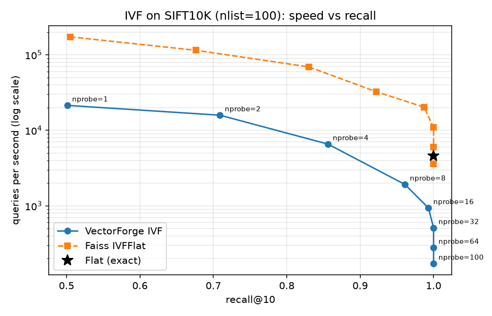

# VectorForge

Approximate nearest-neighbour search written from scratch in NumPy — exact search, IVF, product quantisation and HNSW — benchmarked against Faiss on recall, speed and memory.

> 🚧 In progress: exact search and IVF are done. Product quantisation and HNSW are next.

## Results

SIFT10K (10,000 base vectors, 100 queries, 128 dimensions), k = 10, measured on my laptop. Faiss runs single-threaded for a fair comparison.

| Index | Settings | recall@10 | queries/s | memory (MB) |
|---|---|---|---|---|
| Flat (exact) | — | 1.000 | 4,568 | 5.16 |
| IVF (VectorForge) | nlist=100, nprobe=8 | 0.961 | 1,920 | ≈5.25 |
| IVF (VectorForge) | nlist=100, nprobe=1 | 0.501 | 21,406 | ≈5.25 |
| IVF (Faiss) | nlist=100, nprobe=8 | 0.922 | 32,438 | — |
| IVF-PQ | — | — | — | — |
| HNSW | — | — | — | — |

## IVF: speed vs recall



Full numbers for every nprobe: [`docs/ivf_sweep.csv`](docs/ivf_sweep.csv).

**Findings**

- **Recall rises with nprobe, with strongly diminishing returns.** A query near the border of its cell has some of its true neighbours in the neighbouring cells, and nprobe = 1 never looks there (recall 0.50). Probing 8 of 100 cells — about 8% of the data — already finds 96% of the true neighbours; reaching 100% takes nprobe = 32, four times the work for the last 4%.
- **On 10,000 vectors my IVF is slower than exact search from nprobe = 8 on, even though it does about 10× less arithmetic.** Exact search computes all 100 × 10,000 distances in a single matrix multiply in optimised compiled code. My IVF search loops over the queries in Python, and for each one gathers and copies the candidate vectors. At this size that per-query overhead outweighs the work saved. Exact search's cost grows linearly with the database while IVF's per-query cost stays small, so the picture should flip on SIFT1M (next benchmark).
- **Faiss is roughly 7–22× faster with the same algorithm.** Its search loop runs in compiled C++ with no per-query interpreter overhead, it stores each cell's vectors contiguously in memory instead of gathering them on every query, and it uses SIMD instructions to process several numbers at once.
- **At the same nprobe my recall is about the same as Faiss's at nprobe = 1 and higher from nprobe = 2 to 16** (e.g. 0.961 vs 0.922 at nprobe = 8). Both are IVF; the difference comes from k-means: I initialise with k-means++, while Faiss starts from randomly sampled centroids by default, so the two indexes end up with different cells and different vectors near cell borders. Both reach recall 1.0 once enough cells are probed, which confirms the implementation is correct.

## Run it

```bash
pip install -e ".[dev]"
pytest                          # unit tests
python -m vectorforge.bench     # exact-search benchmark on SIFT10K (see data/README.md to download it)
pip install faiss-cpu
python scripts/sweep_ivf.py     # IVF nprobe sweep vs Faiss → docs/ivf_sweep.csv and .png
```

## Layout

- `vectorforge/io.py` — readers for the `.fvecs` / `.ivecs` dataset format
- `vectorforge/flat.py` — exact search (the baseline)
- `vectorforge/metrics.py` — recall@k
- `vectorforge/kmeans.py` — k-means with k-means++ initialisation
- `vectorforge/ivf.py` — IVF index: k-means cells, inverted lists, nprobe search
- `vectorforge/bench.py` — one harness that measures every index the same way
- `scripts/sweep_ivf.py` — IVF recall/speed sweep against Faiss
